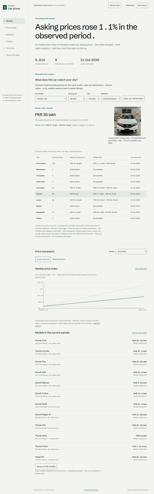

# Pakistan used-car price tracker

What drives used-car asking prices in Pakistan, and how do those prices change
over time? This project collects original observations for educational analysis.
The scraper, cleaning layer, normalized storage, and analysis are implemented.
Versioned public exports and the six-page dashboard are implemented. The dashboard
runs locally; a public deployment and longitudinal market findings are not yet available.

## Current status

- Phase 1: Python 3.10 scaffolding and backend quality gates complete.
- Phase 2: public-page HTTP client, PakWheels adapter, real HTML fixture tests,
  source staging, and the scrape CLI implemented.
- Phase 3: exact price/attribute normalization, quality flags, conservative repost
  candidate marking, and a validated nullable DataFrame contract complete.
- Phase 4: versioned normalized storage, run auditing, status/backup/recovery
  commands, scoped inactivity handling, and scheduling documentation complete.
- Phase 5: matched-cohort and quality-adjusted indexes, observed price drops and
  survival, gated seasonality, validated price drivers, and private analysis CLI complete.
- Phase 6: eight public JSON contracts, privacy/size validation, schema-derived
  TypeScript declarations, fixture snapshots, and export CLI complete.
- Phase 7: accessible dashboard design handoff and verified light/dark palettes complete.
- Phase 8: responsive React dashboard, supported-model price calculator, chart tables,
  runtime data validation, Python/browser parity and browser quality checks implemented.
- Product extension: four-city daily refresh, local medians with year/gearbox
  filters, price quartiles, sample/freshness indicators and reviewed model photos.
  The Windows scheduler installer includes missed-run catch-up.
- Remaining: longer daily collection, supported real-data models/findings and public hosting.



## Run the dashboard

Use Node 20.19 or newer alongside Python 3.10:

```powershell
cd web
npm ci
npm run dev
```

Open the Local URL printed by Vite, normally `http://127.0.0.1:5173/`. Market,
Price drops, Seasons, Drivers, Fair price and About the data all read the committed
exports. Theme and full-price controls, mobile layouts, keyboard navigation and
chart data tables are available. The current sparse sample explains unavailable
analyses; the calculator activates only when the exported model is supported.

On Market, choose a car and buying city to compare local asking prices. Year and
gearbox refinements appear for supported cohorts; at least five usable prices are
required per median. Each car contributes its latest observation within seven
days of the latest collection. Trim, condition and mileage still vary. Photos
show example listings. Use **Refresh data** after the daily export finishes.

See [daily operation](docs/SCHEDULING.md) for the 09:00 Pakistan-time task,
failure inspection and photo review. Source permission is required for automation
and photo reuse; the operator confirmed permission for this local setup.

`make check` now includes the frontend quality gate. Production browser checks,
visual baselines and performance audits are documented in [web/README.md](web/README.md).

## Setup

Python 3.10 is required. Find it before installing anything:

```powershell
py -3.10 --version
py -3.10 -m venv .venv
.venv/Scripts/python.exe --version
make setup
```

If Make is not on Windows PATH, use the existing MSYS2 installation:

```powershell
& 'C:/msys64/usr/bin/make.exe' setup
& 'C:/msys64/usr/bin/make.exe' check
```

On Linux, use `python3.10 -m venv .venv`, then `make setup`. CI sets up Python 3.10
and runs the same Makefile. All Python tools use the venv's interpreter. The lock
file pins build, runtime, and quality dependencies.

## Collect a bounded batch

In PowerShell:

```powershell
$env:TRACKER_CONTACT_EMAIL = "your-contact@example.com"
.venv/Scripts/tracker.exe scrape --source pakwheels --limit-pages 3
```

On Linux, after setting `TRACKER_CONTACT_EMAIL`, use `.venv/bin/tracker` instead.
`--contact-email` is also accepted. See `tracker scrape --help` for all options.

The scraper discovers the ten most numerous models among the site's displayed
model links and allocates a total page budget round-robin. Three pages currently
sample three different models; use at least ten to sample all ten models. The
scope discovery request is additional to the model-search page budget.

New listings receive a detail fetch. Later runs reuse successful details and take
current prices from search pages. An optional `--max-new-details 5` caps initial
detail requests while still storing all search-page summaries; those remaining
details can be collected on later runs. Featured listings may be overrepresented
in small batches, so this is not a representative market sample.

Local outputs (all ignored by Git):

- `data/tracker.sqlite3`: raw staging plus normalized `listings`, `snapshots`, and
  `scrape_runs` tables.
- `data/backups/`: local SQLite backups; never published or committed.
- `data/analysis/`: private typed analysis bundles; never published or committed.
- `raw/cache/v2/`: URL-hashed, same-day vehicle-only HTML cache.

Staging preserves raw source strings. The separate Phase 3 cleaner normalizes
these source values without overwriting them. Staging numeric prices come from
structured offers or numeric HTML attributes; display-only or call-for-price
listings have a null numeric price at that stage. Daily staging
observations keep the latest value on reruns. Normalized snapshots keep the first
observation per listing per UTC day, so later same-day changes do not overwrite
that day's history. A price change on the next day creates a new snapshot.

## Analyze the observations

```powershell
.venv/Scripts/tracker.exe analyze --database data/tracker.sqlite3
# Optional: choose a new output directory (existing directories are refused).
.venv/Scripts/tracker.exe analyze --output data/analysis/review
```

The command reads a consistent SQLite snapshot without modifying or migrating it.
It writes `analysis.json` in a new timestamped directory beneath `data/analysis/`,
containing all four typed results, source counts, dates and assumptions. A valid
analysis with insufficient data exits successfully and explains each unavailable
result. Missing/corrupt databases and existing output paths fail explicitly.

The local sample currently has 90 listings on one observation day. It cannot
establish a price trend, price-drop rate, weekday effect or monthly seasonality.
Synthetic tests verify the methods against known effects; they are not market
findings. More daily observations and adequate attribute coverage are required.
Monthly decomposition needs at least 79 contiguous supported weekly points.
Driver models also require enough complete listings, supported categories and
an identifiable regression; a listing count alone does not establish support.

See [analysis methods](docs/METHODS.md) for filters, weights, censoring, model
validation and prediction assumptions. Private bundles contain internal listing
identifiers and diagnostics. Use the public export command below to prepare data
for the dashboard.

## Export public data

```powershell
.venv/Scripts/tracker.exe export --database data/tracker.sqlite3
```

This reads the database without modifying it, analyzes one consistent observation
snapshot and writes eight versioned files to `web/public/data/`. It also regenerates
JSON Schemas and TypeScript declarations in `web/src/types/`. No separate private
analysis bundle is required, so exports cannot silently reuse a stale report.

Only declared public fields are included. Listing IDs are hashed, recent drop rows
are capped at 100, and residual diagnostics at 200. Contact-pattern and sensitive-field
checks and a strict 500,000-byte budget run before writing any files. Invalid or
oversized exports fail explicitly. Empty/insufficient results remain valid public
files with reasons. Generated files share a digest so consumers can reject mixed
refreshes. Existing generated files are refreshed; unrelated files are retained.

See [the public data contract](docs/EXPORTS.md) for filenames, schema regeneration,
digest checks, population definitions and publication review. The current committed
data describes the small available sample and its insufficient-data states; it
does not claim market findings. The dashboard reads this public contract directly.

Missing or malformed details retain the list summary and produce a nonzero exit
status with an error count. Access challenges or server failures stop collection.
Completed raw pages remain saved; a page interrupted before its commit is not saved.
Normalized listings, snapshots and activity changes are published together only
after the scrape and cleaning step finish. Failed runs publish no partial normalized
observations. Partial runs with detail errors retain their successfully parsed
summaries and do not advance absence counters.
Same-day cached results do not represent a new live observation of the website.

## Clean a fixture batch offline

The pure Python cleaning API accepts source records, validated clean records, or
its own DataFrame output. For example:

```python
from pathlib import Path
from tracker.scraping.pakwheels import parse_list_page
from tracker.cleaning.batch import clean_batch, frame_to_records

html = Path("tests/fixtures/html/pakwheels_list.html").read_text(encoding="utf-8")
frame = clean_batch(parse_list_page(html))
records = frame_to_records(frame)
```

The frame uses nullable `Int64`, `boolean`, and string columns. Features and
`quality_flag` are immutable tuples; missing values remain missing. Prices parse
lakh/crore and Western/Indian comma formats exactly. A valid structured price
takes precedence over display text, and disagreements receive `price_conflict`.
Rows retain URL hashes, not full URLs, and never disappear because of quality flags.

Default flags cover placeholders, prices below PKR 100,000, and deviations greater
than five raw median absolute deviations within make/model/year cohorts with at
least five usable prices. Constant-price cohorts are unflagged; when MAD is zero,
any nonmedian price is flagged. Small/incomplete cohorts skip this statistical
check. Defaults can be changed with `PricePolicy`; these are data-quality rules,
not fair-price estimates.

Possible reposts require complete comparison fields, including seller type, with
exact mileage and at most a symmetric 5% price difference. Unknown seller types do
not match. Known technical conflicts veto matches. `duplicate_of` identifies a
stable candidate root using `source:listing_id`; every row remains available.
These are heuristic candidates, not proof that two advertisements are the same car.

The scrape workflow uses this cleaner before normalized publication. Raw staging
remains intact for debugging; old staging history is not silently backfilled into
invented normalized runs.

## Storage, status and backups

```powershell
.venv/Scripts/python.exe -m tracker.cli backup
.venv/Scripts/python.exe -m tracker.cli migrate
.venv/Scripts/python.exe -m tracker.cli status
.venv/Scripts/python.exe -m tracker.cli status --json
```

Back up an existing database before a manual migration. Fresh scrapes also apply
pending schema initialization automatically. Migrations preserve raw staging,
record the schema version, and reject newer or inconsistent normalized schemas.
Status is read-only and never creates or migrates a database. Backups use SQLite's
online backup API, include committed WAL data, verify integrity and refuse to
overwrite existing destinations. Use `--database PATH` and `--destination PATH`
to select explicit source and backup files.

A listing becomes inactive after three successful missing UTC days in the same
exact source/page scope. Failed/partial runs and same-day repeats do not count.
Reappearing listings reactivate. A bounded page window cannot establish that a
vehicle sold: a listing may simply have moved beyond that window. The inactive
transition records a null-price snapshot, not an invented carried-forward price.

Only one scrape may run at a time. If a process was killed, inspect status, verify
that it has stopped, and explicitly close its run before retrying:

```powershell
.venv/Scripts/python.exe -m tracker.cli recover-run RUN_ID
```

See [daily scheduling and restore instructions](docs/SCHEDULING.md). No scheduled
task is installed automatically.

## Quality gates

```powershell
make check
make test
```

The check target runs Ruff lint/format checks, strict mypy on `src/`, and pytest
with an 85% backend coverage floor, a 95% cleaning gate, and a 90% storage gate.
Default tests block socket connections and use
captured HTML or HTTPX mock transports. See [fixture documentation](tests/fixtures/README.md)
for capture provenance, deliberate refreshes, and the opt-in live smoke test.

## Data flow and limitations

Public HTML → typed source records → SQLite staging → normalization → normalized
listings and daily snapshots → analysis → aggregate JSON → static React dashboard.
Stages after normalized storage remain to be implemented.

Asking prices are not transaction prices. A disappeared listing will be treated as
a proxy for removal or sale, never proof of a sale. One-platform sampling and a
limited set of models create selection bias. The collection window is currently
too short for monthly seasonality, model coefficients, or conclusions about market
trends. At least 18 months of weekly points are required for the planned seasonal
decomposition.

The project uses public pages for personal educational analysis, respects robots
rules, limits requests to at most one every two seconds plus jitter, and stops at
access challenges. The user directed continuation after reviewing the site's terms;
this is not permission from the site. Seller contact details, exact addresses,
descriptions, and photos are unnecessary and omitted from retained markup and
records. No raw database is published. Future exports will contain aggregate data
and hashed identifiers only.

See [the implementation plan](docs/PLAN.md) and [recorded decisions](docs/DECISIONS.md)
for the phase order, data model, testing targets, and future dashboard design.
